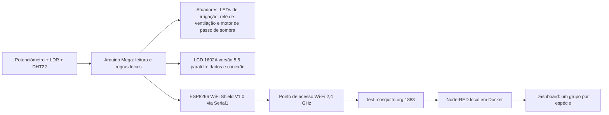

# Material para incorporar à documentação existente

Este arquivo é um roteiro de integração, **não um novo documento de entrega**. Copiar/adaptar o conteúdo aos blocos correspondentes da documentação do Checkpoint 1. Não registrar testes como realizados antes de executá-los.

## Identificação e pendências

- Fernando Artur Luithardt: **1038854**.
- Carlos Eduardo Nogueira de Oliveira: **1028775**.
- Espécies: aroeira-vermelha e ingá.
- Rede implementada: Mega 2560 + ESP8266 WiFi Shield V1.0 informado pela dupla; Serial1 (18/19), firmware AT, WiFiEspAT 1.5.0 e DHCP. Conferir switches, baud e conversão de nível conforme README.
- Substituições: potenciômetro representa umidade do solo; dois LEDs representam irrigação; relé representa ventilação; motor de passo 28BYJ-48 de 5 V com ULN2003 representa a tela de sombreamento (IN1–IN4 nos pinos 40–43, zero aberto assumido manualmente e 1024 meios passos para sombra, ajustável em config.h). Mesmo conjunto de sensores compartilhado pelas duas regras, conforme CP1.
- Preservados: solo aroeira < 30%; sombra aroeira quando leitura relativa de luz > 90%; solo ingá < 60%; ventilação ingá quando temperatura > 25 °C. Luminosidade é percentual relativo do ADC, não lux calibrado.

## Bloco 4 — mensagens e intervalo

Prefixo da dupla: `unidavi/iot/t27/1038854_1028775/{especie}`. Espécies usadas nos tópicos: `aroeira-vermelha` e `inga`.

| Sufixo | Exemplo de formato | Retida | Quando |
|---|---|---|---|
| `sensor/umidade-solo` | `{"valor":32,"unidade":"%"}` | Não | A cada leitura de 8 s, conectado |
| `sensor/luminosidade` | `{"valor":75,"unidade":"%"}` | Não | A cada leitura de 8 s, conectado |
| `sensor/temperatura` | `{"valor":26.5,"unidade":"°C"}` | Não | A cada leitura válida de 8 s, conectado |
| `atuador/irrigacao` | `{"estado":"ligado"}` | Sim | Estado inicial, mudança e reconexão |
| `atuador/sombreamento` (aroeira) | `{"estado":"desligado"}` | Sim | Estado inicial, mudança e reconexão |
| `atuador/ventilacao` (ingá) | `{"estado":"ligado"}` | Sim | Estado inicial, mudança e reconexão |
| `status` | `online` / `offline` (texto simples) | Sim | Conexão / última vontade |

**Os valores acima são exemplos, não capturas reais.** Substituir/complementar com mensagens copiadas do debug do Node-RED. Conferir o intervalo com o requisito funcional do Bloco 4 original.

## Bloco 6 — arquitetura atualizada

Mosquitto local em Docker é usado no teste inicial. O broker online é usado na entrega. Sensores, regras e display independem da rede. O esquema físico deve incluir shield, ligação Serial1 com conversão de nível, LCD e alimentação externa de 5 V do motor com GND comum. O JSON do Wokwi representa as quatro entradas do driver por LEDs; não simula motor, ULN2003 ou shield. Ver docs/montagem.md.

## Bloco 8 — comunicação MQTT

- Uma sessão por espécie, com CLIENT_ID `t27-{matriculas}-{especie}-{DEVICE_ID}`. Assim, cada espécie recebe sua própria última vontade `offline`, QoS 1 e retida.
- Dados e estados publicados com QoS 0 pelo PubSubClient; assinatura Node-RED QoS 1 não aumenta o QoS da publicação. Validar recebimento no debug no intervalo esperado.
- Estados e `online` são republicados após reconexão. Sensores retomam na próxima leitura; não existe armazenamento de amostras offline.
- Keepalive MQTT 15 s, tentativas MQTT espaçadas por pelo menos 5 s e Wi-Fi por 30 s. Durante esperas AT, o adaptador Stream e yield() atendem as tarefas locais; o desenho do LCD usa estados de rede em cache. Verificar a cadência real sob falhas.
- Broker aberto, sem autenticação, conforme CP2. Prefixo identifica a dupla, mas não oferece controle de acesso. Limpar mensagens retidas no final.

## Bloco 9 — dashboard e display

- Dashboard em `/dashboard/estufas`: dois grupos, com solo, luminosidade relativa, temperatura, dois atuadores e status em cada grupo.
- Debug exibe tópico e payload originais. Parser descarta tópicos de outras duplas, JSON inválido, unidades inesperadas e estados desconhecidos.
- LCD 16×2 alterna espécie a cada ciclo e páginas de dados a cada 1,5 s. Exibe sensores/unidades, atuadores, Wi-Fi/MQTT. A frase completa de publicação ocupa duas linhas por aproximadamente 1,5 s após o último envio do lote.
- Sensores indisponíveis: temperatura inválida não é publicada; o display indica erro. Dashboard mantém a última amostra recebida.

### Registro de testes — preencher após execução

| Teste | Resultado esperado | Resultado observado / evidência |
|---|---|---|
| Broker local | Sensores e estados recebidos no debug | Pendente |
| Broker online | Mesmos tópicos recebidos via test.mosquitto.org | Pendente |
| Variar solo/luz/temperatura | LEDs, relé, motor e estados MQTT seguem limiares; motor retorna ao zero para luz ≤ 90% e avança até 1024 meios passos acima disso | Pendente |
| Sem mudança de atuador | Não repetir estado a cada leitura | Pendente |
| Nova assinatura | Receber estados e status retidos | Pendente |
| Desligar ponto de acesso Wi-Fi | Leituras, atuadores e LCD continuam; Wi-Fi OFF; não surge novo aviso de envio | Pendente |
| Aguardar após queda | Broker publica offline para ambas as espécies | Pendente |
| Religar ponto de acesso | Sessões retomam sozinhas; online e estados atuais; sensores retomam | Pendente |
| Parar broker local e reiniciar | Regras/display continuam e MQTT reconecta | Pendente |
| Falha DHT | LCD mostra ERRO, não publica temperatura inválida | Pendente |
| Ciclos sucessivos | LCD alterna espécies e mostra aviso por cerca de 1,5 s após envios | Pendente |

Anexar: foto/vídeo do display com leituras e aviso; vídeo sem rede mantendo leitura e atuação; prints do debug e dos dois grupos do dashboard; `.ino`, `checkpoint2.h`, `atuadores.h`, `config.h`, `wifi_secrets.example.h` (sem senha real), `libraries.txt` e fluxo `flows.json`.

## Bloco 10 — avaliação por pares (atividade presencial pendente)

- Dupla avaliada / matrículas: **preencher**.
- Data e cenário observado: **preencher**.
- O que funcionou, com evidência observada: **preencher**.
- O que falhou ou faltou, incluindo condição em que ocorreu: **preencher**.
- Ao menos uma sugestão técnica e motivo: **preencher**.

Não substituir a observação do protótipo por uma avaliação hipotética.
