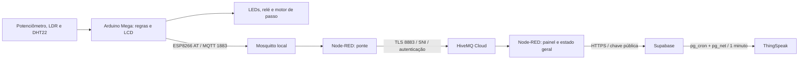

# Configuração e entrega do Checkpoint 3

## Arquitetura

Conforme orientação informada pela dupla: MQTT local de entrada → Node-RED como ponte → MQTTS de saída. O shield continua com firmware AT 1.7. TLS termina no computador do Node-RED; o trecho Mega–Mosquitto permanece em texto claro na rede local. A verificação do certificado cloud permanece ativada.



Painel e banco recebem o **retorno do HiveMQ**, evitando aparentar sucesso apenas com uma cópia local. Publicação e assinatura compartilham uma conexão cloud. O tópico adicional `unidavi/iot/t28/1038854_1028775/ponte/status` informa a saúde da ponte e tem última vontade `offline`. Os tópicos por espécie mantêm o formato do CP2, agora em `t28`.

## 1. Rede e Node-RED

1. Copie `cp3/.env.example` para `cp3/.env`, ignorado pelo Git.
2. `CP3_MODE=preview` desativa as conexões. Para testes reais, use `CP3_MODE=teste` e os dados da **sua conta** HiveMQ.
3. Gere `NODE_RED_CREDENTIAL_SECRET` com `openssl rand -hex 32` e guarde o valor no `.env`.
4. Na conta própria, limite a credencial a publicar/assinar `unidavi/iot/t28/1038854_1028775/#`.
5. No firmware, `MQTT_HOST` é o IP LAN do computador e a porta é 1883. Copie `wifi_secrets.example.h` para `wifi_secrets.h` e preencha a rede localmente.
6. Inicie pelo comando Docker do README. Se um broker antigo ocupar 1883, pare-o antes de iniciar o CP3. O painel final usa 1881.
7. Após mudar `.env`, execute `docker compose --env-file cp3/.env -f cp3/docker-compose.yml up -d --force-recreate nodered`.

O dashboard e o editor `/editor` ficam em localhost por padrão. Para acesso pela rede, configure `DASHBOARD_BIND` e `NODE_RED_ADMIN_HASH` (hash bcrypt gerado por `node-red admin hash-pw`). O Mosquitto local limita tópicos por ACL, mas continua sem autenticação/TLS; use a rede controlada da demonstração.

`prepare.cjs` aplica o fluxo versionado a cada inicialização. Altere permanentemente `build-flow.cjs`, os templates e os módulos e execute `npm run build`. Exporte alterações manuais do editor antes de reiniciar, pois serão substituídas. Contexto, histórico e fila são preservados no volume de dados.

## 2. Supabase

Execute `cp3/supabase/supabase_schema.sql` inteiro no projeto dedicado à atividade. Mantém as dez tabelas do professor e cadastra `1038854_1028775`, `aroeira-vermelha` e `inga`. Configure `SUPABASE_URL` e `SUPABASE_KEY` no `.env` e recrie o Node-RED.

Use apenas a chave **anon** ou **publishable**. O código recusa `service_role`/`sb_secret_`. A chave pública tem INSERT nas quatro tabelas, sem SELECT, UPDATE ou DELETE. O cabeçalho é `Prefer: return=minimal`; `Authorization` é enviado apenas para anon JWT. A política admite somente a dupla e suas espécies. Quem possuir a chave pública ainda poderá inserir dados falsos; ela não prova a identidade da placa.

A coluna `evento_id` e um trigger complementam o modelo para tornar os POSTs idempotentes. A fila só remove eventos após HTTP 2xx; novas tentativas mantêm o UUID. O trigger ignora duplicatas sem conceder leitura à chave pública. O contexto é descarregado em disco a cada segundo: corte abrupto pode perder o último segundo em cache. A fila comporta 50.000 eventos; excedentes são contados e sinalizados.

Confira os dados no Table Editor e com `cp3/supabase/conferir.sql`.

## 3. ThingSpeak

Crie o canal e, no Table Editor do Supabase, preencha `thingspeak_canal` e `thingspeak_write_key` na linha da dupla em `integracoes`. A chave de escrita não vai para o Node-RED nem para os arquivos entregues.

| Campo | Conteúdo |
|---|---|
| 1 | Luminosidade (%) |
| 2 | Umidade do solo (%) |
| 3 | Umidade do ar (%) — sem dado neste protótipo; não inventar zero |
| 4 | Temperatura (°C) |
| 5 | 0 OFFLINE, 1 SEM DADOS, 2 ALERTA, 3 ATUANDO, 4 NORMAL, 5 INATIVA |
| 6 | Quantidade de atuadores ligados |
| 7 | 9 aroeira-vermelha; 6 ingá |
| 8 | Idade da última leitura, em segundos |

Execute `agendar_thingspeak.sql`: ativa `pg_net`, `pg_cron` e agenda envio por minuto. Como no modelo fornecido, o canal representa a espécie do dado mais recente, identificada pelo campo 7. Não é um canal independente por espécie.

Confira `v_thingspeak_payload`, `cron.job_run_details` e `net._http_response`. Sucesso no cron não basta: corpo `0` do ThingSpeak indica falha. A atualização depende também do tempo de processamento do serviço.

## 4. Regras e painel

| Espécie | Sensor | Condição | Atuador |
|---|---|---|---|
| Aroeira-vermelha | umidade-solo | < 30% | irrigacao |
| Aroeira-vermelha | luminosidade | > 90% | sombreamento |
| Ingá | umidade-solo | < 60% | irrigacao |
| Ingá | temperatura | > 30 °C | ventilacao |

Em 30 °C a ventilação fica desligada. O ajuste de 25 para 30 °C corrige o firmware para o cenário oficial.

Cada aba mostra os dois sensores do seu cenário. Os sensores compartilhados adicionais publicados pelo firmware também são gravados no Supabase e podem alimentar o ThingSpeak. Temperatura fora de 0–50 °C mantém o número real e satura o medidor/gráfico. Luminosidade é percentual relativo, não lux calibrado.

Recálculo a cada 5 s, com prioridade OFFLINE → SEM DADOS → ALERTA → ATUANDO → NORMAL. Idade maior que 24 s em qualquer sensor do cenário resulta em SEM DADOS; divergência conhecida por mais de 16 s resulta em ALERTA. Durante a tolerância, o painel indica que aguarda sincronização. Estado desconhecido não é considerado NORMAL. Perda do broker/ponte invalida a atualidade, mas não inventa uma última vontade da placa.

O horário é o da recepção no Node-RED, pois o payload do CP2 não tem timestamp da placa. Estado retido aparece como **Observado desde**, sem inventar a hora real da mudança. Últimos valores ficam esmaecidos quando não são atuais. O histórico local guarda 30 minutos, com lacunas quando a leitura para, e não se perde ao trocar de aba. O Supabase guarda o histórico longo; a chave insert-only não o consulta de volta.

## 5. Segurança e conta final

Na sua conta de teste:

```sh
node --env-file=cp3/.env cp3/scripts/testar-seguranca.cjs
```

O teste verifica TLS/certificado, recusa sem credenciais, permissão no prefixo e negação em `cp3-teste-negado/1038854_1028775/verificacao`. Esse namespace de diagnóstico fica na sua conta; não corresponde a outra equipe. Timeout/falha de rede é inconclusivo. O script proíbe a conta final.

Somente na entrega, use `CP3_MODE=entrega` e os dados da ficha no `.env`. Servidor: `a8bb7dc1940348a7939da47ef2447f98.s1.eu.hivemq.cloud`; usuário: `projeto_iot`. A senha da ficha não foi copiada para os arquivos. A credencial compartilhada não isola equipes; mantenha o prefixo da dupla. O Node-RED valida a CA pública (incluindo ISRG Root X1), o hostname e usa SNI. Não há desativação da validação na configuração final.

## 6. Evidências e limites

Testes automatizados: regras/limiares, tempo dos estados, validação, retenção, reconexão, histórico, fila, RLS, idempotência, campos do ThingSpeak, interface e ponte MQTT/TLS com endpoints locais. Dados do teste visual são sintéticos. A execução real de `pg_net`/`pg_cron`, as contas cloud e o hardware ainda precisam de validação.

| Ensaio real | Evidência |
|---|---|
| Provocar sensores nas duas espécies | NORMAL/ATUANDO, LCD e atuadores |
| Interromper sensor por > 24 s | SEM DADOS e idade |
| Divergir atuador por > 16 s, mantendo leituras | ALERTA e regra esperada |
| Desligar/religar placa ou Wi-Fi | OFFLINE por LWT e recuperação |
| Derrubar Node-RED–HiveMQ | Conexão perdida, valores não atuais |
| Executar por pelo menos 30 minutos | Curvas e limiares |
| Supabase e ThingSpeak reais | Quatro tabelas, payload, canal e agendamento |
| ACL na conta própria | Recusa sem credenciais e fora do prefixo |

O motor de passo assume posição aberta ao iniciar. Após falta de energia, verificar/reposicionar a tela; não há homing automático. Essa limitação não deve ser apresentada como reinicialização autônoma da posição.

## 7. Apresentação (até 8 minutos)

| Tempo | Integrante sugerido | Conteúdo |
|---|---|---|
| 1 min | Carlos | Espécies, substituições e regras |
| 2 min | Fernando | Arquitetura, ponte, tópicos e armazenamento |
| 3 min | Ambos | Duas espécies, LCD, histórico, banco e canal |
| 1 min | Fernando | TLS, ACL e limites de segurança |
| 1 min | Carlos | Aprendizados e limitação do motor |

Preencher data, URL do Supabase sem chave, evidências reais e assinaturas na documentação existente. Não entregar `.env`, `wifi_secrets.h`, credenciais, dumps de `integracoes` ou ficha com senha.

## Referências

- Anexos do professor em `Arquivos do Trabalho 03/`: cenário, layout, modelo SQL e ordem dos campos.
- [WiFiEspAT / limitações AT 1.7](https://github.com/JAndrassy/WiFiEspAT#limitations).
- [Variáveis do Node-RED](https://nodered.org/docs/user-guide/environment-variables).
- [FlowFuse ui-template](https://dashboard.flowfuse.com/nodes/widgets/ui-template.html). Foi mantido o Dashboard 2 do CP2; medidores e gráficos seguem o padrão em componentes ui-template.
- [Chaves do Supabase](https://supabase.com/docs/guides/getting-started/api-keys) e [Cron](https://supabase.com/docs/guides/cron/quickstart).
